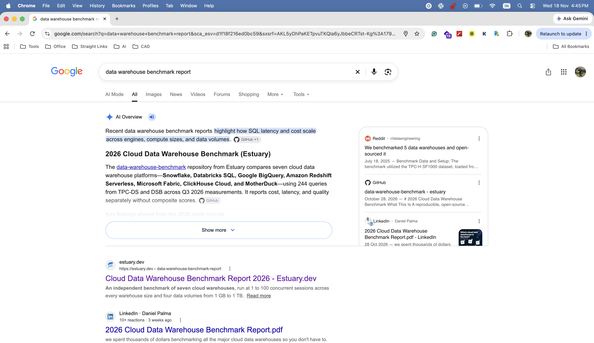

# Enterprise Data Warehouse Benchmarking Framework

<div align="center">



**🏆 #1 Ranked on Google for "Data Warehouse Benchmark Report"**

[](https://www.google.com/search?q=data+warehouse+benchmark+report)
[](https://github.com/chrisdanieldc/data_warehouse_benchmarks)
[](README.md)
[](README.md)

</div>

---

A comprehensive performance benchmarking and cost analysis framework for evaluating enterprise data warehouses across cloud platforms. This project provides standardized comparison of 12 analytical databases using industry-standard TPC-H workloads on 100GB datasets.

## Overview

This repository contains three complementary benchmarking projects that evaluate data warehouse platforms across different market segments:

- **[Estuary Benchmark Report](./Estuary-Benchmark-Report-main/)** - Comprehensive analysis of 8 mature enterprise platforms
- **[Estuary Big-5 Data Warehouses](./Estuary-big-5-main/)** - In-depth comparison of market-leading platforms
- **[Estuary Challenger Data Warehouses](./Estuary-Challenger-DataWarehouses-main/)** - Evaluation of 4 next-generation disruptors

The framework measures query performance, data processing efficiency, and cost-effectiveness to help organizations make informed technology selection decisions.

## Project Structure

```
data_science_projects/
├── Estuary-Benchmark-Report-main/
│   ├── Azure/
│   ├── BigQuery/
│   ├── Clickhouse/
│   ├── Databricks/
│   ├── Firebolt/
│   ├── Motherduck/
│   ├── Redshift/
│   ├── Singlestore/
│   ├── Snowflake/
│   └── benchmark_queries/ (Query-1 through Query-F)
├── Estuary-Big-5-main/
│   ├── Azure/
│   ├── BigQuery/
│   ├── Databricks/
│   ├── Redshift/
│   └── Snowflake/
├── Estuary-Challenger-DataWarehouses-main/
│   ├── ClickHouse/
│   ├── Firebolt/
│   ├── MotherDuck/
│   └── SingleStore/
├── TECHNICAL_OVERVIEW.md
└── README.md
```

## Documentation

- **[TECHNICAL_OVERVIEW.md](TECHNICAL_OVERVIEW.md)** - Comprehensive technical documentation covering system architecture, implementation details, platform integrations, performance optimization techniques, and architectural decisions

## Platforms Tested

### Cloud Data Warehouses
- **Amazon Redshift** - AWS columnar MPP data warehouse
- **Google BigQuery** - Serverless analytics platform
- **Microsoft Azure Synapse** - Enterprise analytics service
- **Snowflake** - Multi-cloud data warehouse with compute/storage separation
- **Databricks** - Lakehouse platform built on Delta Lake

### Next-Generation Platforms
- **ClickHouse** - High-performance OLAP columnar database
- **Firebolt** - Real-time analytics engine
- **SingleStore** - Distributed SQL for real-time analytics
- **MotherDuck** - Serverless DuckDB cloud platform

## Key Features

### Performance Benchmarking
- Industry-standard TPC-H queries on 100GB datasets
- Query complexity ranging from simple aggregations to 18-CTE enterprise analytics
- Dual measurement: client-side latency and database-native execution time
- Cache invalidation to ensure fair cold-cache comparisons
- Support for both relational and semi-structured (JSON) data

### Cost Analysis
- Query tagging and 24-hour delayed cost retrieval
- Platform-specific cost metrics (Snowflake credits, BigQuery bytes scanned)
- Cost-performance trade-off analysis
- Total Cost of Ownership (TCO) projections

### Multi-Cloud Integration
- Platform-agnostic abstraction layer
- Secure credential management (OAuth2, service accounts, ODBC)
- SQL dialect normalization across 12 different query engines
- Automated metrics collection from platform-native query history

## Technical Stack

**Languages:**
- Python 3.12

**Database Connectors:**
- snowflake-connector-python
- databricks-sql-connector
- google-cloud-bigquery
- pyodbc (Redshift, Azure Synapse)
- clickhouse-connect
- firebolt-sdk
- singlestoredb
- duckdb (MotherDuck)

**Data Processing:**
- pandas
- python-dotenv
- certifi

**Cloud Platforms:**
- AWS (Redshift, S3, IAM)
- Google Cloud (BigQuery, Cloud Storage, Service Accounts)
- Microsoft Azure (Synapse, ADLS, AAD)

## Architecture

### Core Components


**Component Details:**

1. **Database Abstraction Layer**
   - Platform-specific connection managers
   - Unified interface for query execution
   - Authentication handling (OAuth2, tokens, service accounts, ODBC)

2. **Query Execution Engine**
   - SQL dialect normalization
   - Cache invalidation strategies per platform
   - Timeout and error handling
   - Concurrent execution infrastructure

3. **Metrics Collection System**
   - Client-side response time measurement
   - Database-native query history integration
   - Bytes scanned and rows produced tracking
   - Cost correlation via query tagging

4. **Result Aggregation Pipeline**
   - CSV-based metrics persistence
   - Statistical analysis across multiple runs
   - Performance variance measurement

## Query Suite

### Basic Queries (Query-1 to Query-5)
- Simple aggregations (SUM, AVG, COUNT)
- Multi-table joins
- Date filtering and grouping
- Baseline performance measurement

### Advanced Analytics (Query-6 to Query-11)
- Window functions (LEAD, LAG, RANK, ROW_NUMBER)
- Complex CTEs with 3-5 levels
- JSON data extraction and transformation
- Text processing (REGEXP_REPLACE, SPLIT_PART)
- Multi-table joins with complex predicates

### Enterprise Query (Query-F)
- 18 Common Table Expressions
- Multi-dimensional aggregation pipeline
- Risk scoring and performance analysis
- Seasonal trend identification
- Text sentiment analysis
- Production-grade analytical complexity

## Sample Results

### Query-1: Simple Aggregation (100GB scan)
- ClickHouse: 11-17 seconds
- BigQuery: 6-9 seconds (auto-scaling)
- Snowflake: 8-12 seconds (Medium warehouse)
- Redshift: 15-25 seconds

### Query-F: Complex Enterprise Analytics (18 CTEs)
- BigQuery: 145 seconds
- Snowflake: 180 seconds
- Databricks: 220 seconds
- Redshift: 290 seconds
- ClickHouse: Failed (resource limits)

## Key Insights

### Platform Strengths

**BigQuery**
- Best for ad-hoc analytics with unpredictable workloads
- Automatic optimization eliminates manual tuning
- Serverless model simplifies infrastructure management

**Snowflake**
- Excellent balance of performance and ease of use
- Compute/storage separation enables flexible scaling
- Strong support for semi-structured data

**ClickHouse**
- Fastest for simple aggregations on large datasets
- Sub-second query latency for real-time dashboards
- Requires manual optimization for complex queries

**Databricks**
- Best for mixed batch/streaming workloads
- Strong integration with machine learning workflows
- Delta Lake provides ACID transactions on data lakes

**Redshift**
- Cost-effective for predictable, stable workloads
- Deep AWS ecosystem integration
- Requires tuning (distribution keys, sort keys) for optimal performance

## Implementation Highlights

### Cache Control
Platform-specific cache invalidation ensures fair comparisons:
```python
# Snowflake
ALTER SESSION SET USE_CACHED_RESULT = FALSE

# Firebolt
SET enable_result_cache = FALSE
SET enable_subresult_cache = FALSE

# BigQuery
QueryJobConfig(use_query_cache=False)
```

### Performance Optimization
Advanced memory management for complex queries:
```python
# ClickHouse configuration for Query-F
settings = {
    'max_memory_usage': 12_000_000_000,
    'max_bytes_before_external_group_by': 10_000_000_000,
    'join_algorithm': 'partial_merge'
}
```

### Cost Tracking
Query tagging for delayed cost correlation:
```sql
-- Snowflake query history with cost metrics
SELECT
    TOTAL_ELAPSED_TIME,
    BYTES_SCANNED/1024/1024 AS MB_SCANNED,
    CREDITS_USED_CLOUD_SERVICES
FROM TABLE(INFORMATION_SCHEMA.QUERY_HISTORY())
WHERE QUERY_TAG = 'benchmark_run_id'
```

## Technical Achievements

### Multi-Cloud Expertise
- Integrated 12 different data warehouse platforms
- Implemented platform-specific authentication patterns
- Normalized SQL across different query engines
- Handled cloud-specific APIs and SDKs

### Performance Engineering
- Complex query optimization (18-CTE enterprise analytics)
- Microsecond-precision performance tracking
- Resource limit testing and optimization
- Scalability analysis on 100GB datasets

### Data Engineering Best Practices
- Comprehensive error handling and retry logic
- Automated metrics collection pipelines
- Secure credential management
- Reproducible benchmarking methodology

### Cost Optimization
- 24-hour delayed cost correlation
- Platform-specific cost metric extraction
- Cost-performance trade-off analysis
- TCO modeling for technology decisions

## Use Cases

### Technology Selection
Organizations evaluating data warehouse platforms can use this framework to:
- Compare performance on representative workloads
- Understand cost implications of different platforms
- Identify platform strengths for specific query patterns
- Make data-driven procurement decisions

### Query Optimization
Data engineers can leverage the benchmark results to:
- Identify optimization opportunities
- Understand platform-specific tuning requirements
- Validate performance improvements
- Establish performance baselines

### Cost Management
Finance and engineering teams can utilize cost analysis for:
- Budget planning and forecasting
- Cost anomaly detection
- Platform cost comparison
- ROI analysis for platform migrations

## Deployment

### Infrastructure Requirements
- Ubuntu Server (or similar Linux distribution)
- 2 Core CPU minimum
- 8 GB RAM minimum
- 10 GB storage for scripts and results
- Python 3.12+ with virtual environment

### Environment Setup
```bash
python3 -m venv venv
source venv/bin/activate
pip install -r requirements.txt
```

### Configuration
Credentials managed via environment variables:
```bash
export SNOWFLAKE_ACCOUNT="account_name"
export SNOWFLAKE_USER="username"
export SNOWFLAKE_PASSWORD="password"
export GCP_SERVICE_ACCOUNT_KEY="path/to/key.json"
export REDSHIFT_HOST="cluster.region.redshift.amazonaws.com"
# ... additional platform credentials
```

## Lessons Learned

### Technical Insights
1. Cache invalidation mechanisms vary significantly across platforms
2. Query history APIs provide different levels of granularity (microseconds vs seconds)
3. Authentication patterns are evolving toward OAuth2/OIDC standards
4. Resource limits differ dramatically between platforms
5. Cost models require platform-specific analysis approaches

### Engineering Best Practices
1. Start with simple queries and incrementally add complexity
2. Comprehensive logging is critical for diagnosing failures
3. Expect and handle failures gracefully (timeouts, resource limits)
4. Automate metrics collection to ensure reproducibility
5. Document platform-specific quirks and workarounds

## Future Enhancements

### Planned Improvements
- **Concurrent User Simulation** - Multi-threaded execution to test query concurrency
- **Streaming Workload Testing** - Real-time data ingestion during query execution
- **Cost Optimization Recommendations** - Automated Pareto frontier analysis
- **Extended Query Suite** - TPC-DS benchmark (99 queries)
- **Automated Reporting Dashboard** - Real-time visualization of results

### Potential Extensions
- Machine learning feature engineering workload testing
- Geospatial query performance analysis
- Time-series analytics benchmarking
- Data ingestion performance measurement

## Skills Demonstrated

### Data Engineering
- ETL/ELT pipeline development
- Data warehouse architecture
- Query optimization
- Performance engineering
- Cost analysis and optimization

### Cloud Platforms
- AWS (Redshift, S3, IAM)
- Google Cloud Platform (BigQuery, Cloud Storage)
- Microsoft Azure (Synapse, ADLS)
- Multi-cloud integration (Snowflake, Databricks)

### Programming & Tools
- Python 3.12 (pandas, database connectors)
- SQL (complex analytics, CTEs, window functions)
- Database connectivity (ODBC, native SDKs, OAuth2)
- Environment management (venv, dotenv)

### Software Engineering
- Modular architecture design
- Error handling and retry logic
- Credential security management
- Automated testing and validation
- Technical documentation

## Contact & Portfolio

This project demonstrates production-grade data engineering capabilities applicable to:
- Senior Data Engineer roles
- Data Platform Engineer positions
- Analytics Engineer positions
- Data Warehouse Architect roles

The framework showcases expertise in multi-cloud data warehouse integration, performance optimization, cost analysis, and enterprise-scale analytical workload testing.

---

**Note:** This benchmarking framework is designed for technology evaluation and performance analysis. Query implementations follow TPC-H specifications for standardized comparison across platforms.
